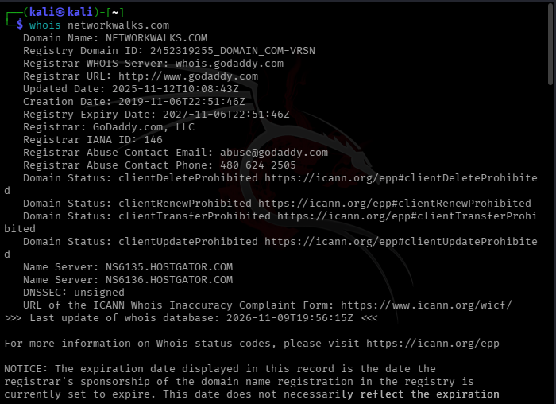
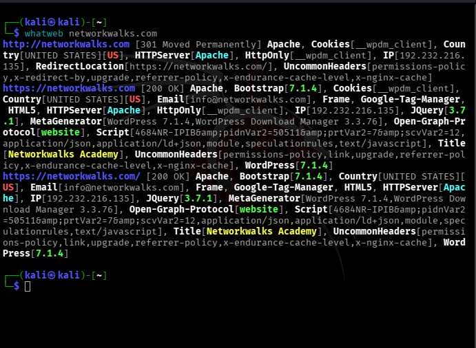
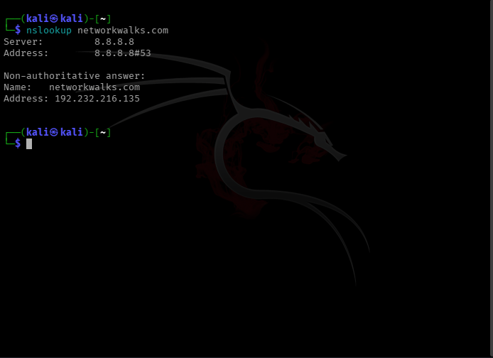
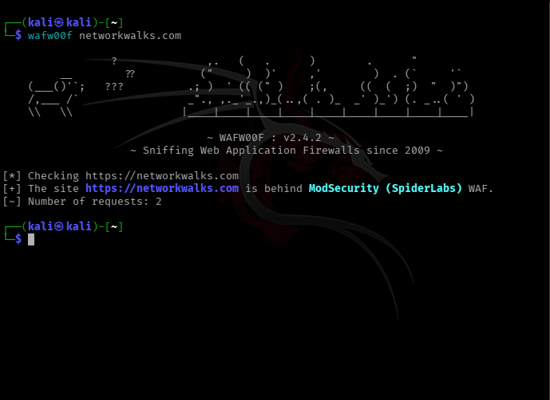
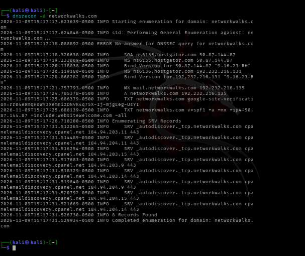
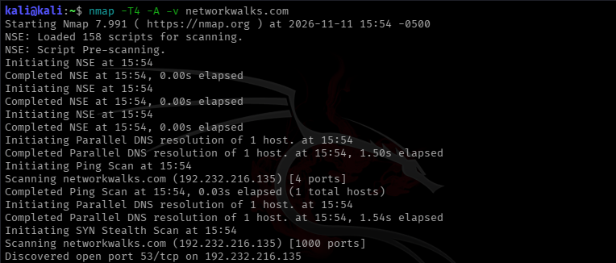
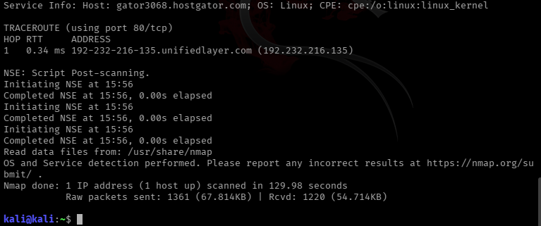
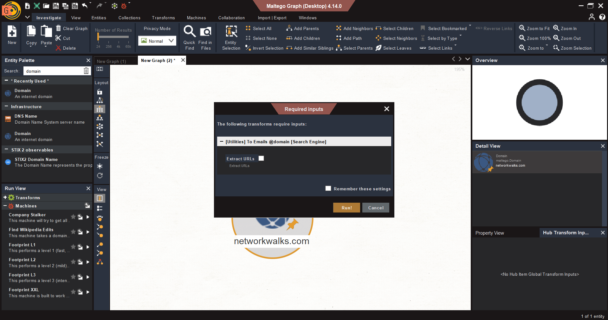

# NETWORKWALKS-B084-WK2-PM1-5-FOOTPRINTING-RECONNAISSANCE


##  FOOTPRINTING, NETWORK SCANNING AND VULNERABILITY ASSESSMENT / ANALYSIS

| Field | Information |
| --- | --- |
|  Cybersecurity Student | Peter Kariuki |
|  Program / Batch | B084 - Networkwalks |
|  Date | 08 November 2026 |
|  Modules Completed | WK2 Footprinting with multiple Kali tools + Zenmap Scanning + GHDB + Maltego + theHarvester|
|  Client / Target | Networkwalks (secured with permission already) / scanme.nmap.org (for Zenmap) |
|  Permission secured from client? | Yes |
|  Phases covered | Phase 1. Reconnaissance and Footprinting / Phase 2. Scanning and Network Discovery / Phase 3. Vulnerability Assessment / Analysis |

---

## ⚖️ 1. LIABILITY DISCLAIMER

- I have performed these activities only on the systems & devices where I had secured written permission or the devices / systems that I own myself.
- All these materials are for education and research purpose only.
- Do not use anything from here to break the law.
- The instructor, the authors and Networkwalks are not responsible for what you do with this knowledge.
- Every action you take is your own responsibility.
- Misuse can lead to criminal charges, heavy fines, loss of your job and a permanent record.
- In most countries unauthorised access is a crime even when nothing is damaged.

---

## 📖 2. INTRODUCTION

This report documents my Week 2 work as part of my ongoing internship program at Networkwalks. It covers footprinting the networkwalks.com domain using multiple Kali Linux tools (W2-PM1) and network scanning using Zenmap on scanme.nmap.org, the official Nmap test target.

The activities focus on different reconnaissance and information-gathering techniques, from:
- Collecting publicly available information about a target
- Identifying live hosts and services within a network
- Understanding the target's public-facing infrastructure
- Visualizing network topology and OS detection using Zenmap

For each activity, I documented:
- Commands performed
- Results observed
- Screenshots as evidence
- Short explanation of why the information could be relevant from a security perspective

---

## 🛠️ 3. TOOLS USED

| Tool | Purpose |
| --- | --- |
| Kali Linux | Operating system used for reconnaissance activities |
| whois | Find who owns the domain, when it was registered, and its name servers |
| whatweb | Fingerprint web technologies (server, CMS, plugins, IP) |
| nslookup | Resolve the domain name to its IP address using DNS |
| curl -I | Read the HTTP response headers of the website |
| wafw00f | Detect whether a Web Application Firewall protects the site |
| dnsrecon | Enumerate all DNS records (NS, MX, SPF, TXT, SRV) |
| nmap / Zenmap | Scan to find live hosts, open ports, services and versions |
| Zenmap | Graphical interface for Nmap - for topology, ports/hosts view and OS detection |

### 💻 Lab Configuration

| Component | Configuration |
| --- | --- |
| Host OS | Parrot OS |
| Attacker Machine | Kali Linux (VM) |
| Target 1 | networkwalks.com |
| Target 1 IP | [REDACTED - Hidden for Privacy] |
| Target 2 (Zenmap) | scanme.nmap.org |
| Target 2 IP | 10.0.128.20 |
| Tools Used | whois, whatweb, nslookup, curl, wafw00f, dnsrecon, nmap, Zenmap |

---

##  4. ACTIVITIES PERFORMED

### 4.1. Footprinting with multiple Kali tools

As part of the reconnaissance phase, I analyzed the networkwalks.com domain using seven different tools available in Kali Linux: WHOIS, WhatWeb, Nslookup, Curl, Wafw00f, DNSRecon and Nmap.

Each tool provided a different perspective of the target, allowing me to gradually build a broader picture of its domain, DNS, and web infrastructure.

---

### 🔹 Step 1. WHOIS Lookup

Command: whois networkwalks.com



Findings:
- Domain is registered and publicly available
- Registrar, creation date, expiry date and name servers were identified
- Registrant information is privacy-protected
- Hosting provider identified as HostGator

---

### 🔹 Step 2. WhatWeb - Technology Fingerprinting

Commands: whatweb networkwalks.com / whatweb -v networkwalks.com



Findings:
- Website is built on WordPress 7.1.4
- Plugin identified: WP Download Manager 3.3.76
- Server and other web technologies were fingerprinted
- This information helps to identify outdated / vulnerable versions

---

### 🔹 Step 3. Nslookup - DNS Resolution

Command: nslookup networkwalks.com



Findings:
- Domain resolves to IP address: [REDACTED]
- DNS server responded successfully
- Confirmed the target is live and reachable

---

### 🔹 Step 4. Curl - HTTP Header Inspection

Command: curl -I https://networkwalks.com


Findings:
- HTTP response code: 200 OK
- Server header information collected
- Content-Type, Date and other security headers observed
- Server is running and responding to HTTPS requests

---

### 🔹 Step 5. Wafw00f - WAF Detection

Commands: wafw00f networkwalks.com / wafw00f https://networkwalks.com



Findings:
- WAF Detected: ModSecurity (SpiderLabs)
- The site is protected by a Web Application Firewall
- This means direct attacks will be filtered / blocked

---

### 🔹 Step 6. Dnsrecon - DNS Enumeration

Command: dnsrecon -d networkwalks.com



Findings:
- DNS enumeration performed successfully
- Name servers, mail servers (MX) and other DNS records identified
- DNS Server: Bind 9.16.23
- SPF record found
- cPanel related records found

---

### 🔹 Step 7. Nmap - Port Scanning & Service Detection

Commands: nmap -sV networkwalks.com / nmap -T4 -A -v networkwalks.com




Findings:
- Target is live and responding to scan
- Open ports identified: Port 80 (HTTP) and Port 443 (HTTPS)
- Services running on open ports were detected
- Service version detection performed using -sV option
- Other ports are filtered / closed due to firewall protection
- This helps to understand which services are exposed to the internet

Summary: By combining the results from all seven tools, I was able to collect information from several different layers of the target's public-facing infrastructure.

---

### 🔹 Step 8. Zenmap - Graphical Network Scanning

For Zenmap scanning, I used scanme.nmap.org which is the official test target provided by Nmap for legal scanning practice. This allowed me to perform an Intense Scan without scanning an unauthorized target.

Profile Used: Intense Scan
Command: nmap -T4 -A -v scanme.nmap.org



Findings:
- Target: scanme.nmap.org is live and responding
- Host is up, latency observed
- OS Detection performed with Nmap -A option
- Service and version detection completed
- Traceroute information collected

#### 8.1 Ports / Hosts View


Findings:
- Multiple open ports identified (example: 22 SSH, 80 HTTP, 110, 587, 2222, 3306 and others)
- Each open port shows its service name and version
- Ports tab in Zenmap gives a clear list of all open ports in one view
- This view helps to quickly identify which services are exposed

#### 8.2 Topology View


Findings:
- Topology view shows the network path from localhost (attacker machine) to the target host
- Target host is shown as a node at the end of the route
- Topology helps to understand how many hops are between attacker and target

#### 8.3 Hosts Viewer


Findings:
- Hosts Viewer shows OS details - OS match: Linux with high accuracy
- Hosts Viewer also shows open ports count and host details in one place

Summary: Zenmap made the Nmap results easier to understand visually. Intense Scan gave ports, services, OS and traceroute in one scan, while Ports/Hosts, Topology and Hosts Viewer views helped to analyze the same results from different angles.

---

##  5. ERRORS FACED & SOLUTIONS

During this task I faced errors. The error screenshots are saved in the errors folder in this repo.


| Error | Cause | Solution |
| --- | --- | --- |
| dnsrecon - command not found | dnsrecon was not installed by default in Kali VM | Installed using - sudo apt update && sudo apt install dnsrecon -y |
| whois - Timeout / No response | Slow internet in VM / Server response delay | Ran the command again after few seconds, got full output |
| curl - SSL / Connection delay | HTTPS handshake took time / Network delay | Used curl -I with https, waited, checked internet connection |
| wafw00f - Slow scan | WAF detection sends multiple requests, takes time | Waited for scan to complete without closing terminal |
| nmap - Slow scan / Filtered ports | Firewall blocking / filtering some ports | Used nmap -sV, waited for scan to complete, checked open ports 80 and 443 only |
| Zenmap - Scan took time | Intense Scan (-A) does OS + version + traceroute, takes longer | Waited for scan to finish, did not close Zenmap, checked Nmap Output tab |


---

##  6. RISK ANALYSIS / IMPACT

| # | Risk / Finding | Evidence / Observation | Potential Impact | Risk Level |
| --- | --- | --- | --- | --- |
| 1 | Domain registration and infrastructure information exposed | WHOIS revealed registrar and HostGator name servers. Registration and expiry dates are publicly available | Information can support reconnaissance and help attackers understand the domain's infrastructure | Low |
| 2 | Web technology information exposed | WhatWeb identified WordPress 7.0.4 and WP Download Manager 3.3.58 | Attackers may use exposed technology / version information to identify software requiring further security review | Medium |
| 3 | Server IP address identifiable | Nslookup resolved the domain to [REDACTED] | Provides information about the network location of the web service | Low |
| 4 | HTTP technical information exposed | Curl returned HTTP response headers | May assist technology fingerprinting and further enumeration | Low |
| 5 | WAF technology identifiable | Wafw00f identified ModSecurity (SpiderLabs) | Reveals information about the web application's security architecture | Low |
| 6 | DNS infrastructure information exposed | Dnsrecon identified DNS, mail, and service-related records, Bind 9.16.23 | DNS information can help build a broader infrastructure profile | Medium |
| 7 | Open ports and services exposed (networkwalks.com) | Nmap identified open ports 80 and 443 | Every open service widens the attack surface | Medium |
| 8 | Multiple open ports and services exposed (scanme.nmap.org - Zenmap) | Zenmap Intense Scan on scanme.nmap.org identified multiple open ports with service versions, including 22, 80, 3306 and 2222 | Each open service is a potential entry point if not patched and hardened. Exposed database port 3306 increases risk | High |
| 9 | OS information exposed (Zenmap) | Zenmap Hosts Viewer identified OS as Linux with high accuracy | OS fingerprinting helps attackers select OS-specific techniques | Low |

Risk Level Key: Critical / High / Medium / Low

The risks listed above are based on observations made during the footprinting and network scanning exercises and should not be considered confirmed vulnerabilities. No exploitation or vulnerability verification was carried out during this module.

---

##  7. RECOMMENDATIONS

| # | Finding | Recommendation |
| --- | --- | --- |
| 1 | Domain registration information exposed | Enable domain privacy where appropriate and minimize publicly available administrative information |
| 2 | Web technology information exposed | Keep WordPress and all installed plugins updated, remove unused components, and regularly assess exposed software for known vulnerabilities |
| 3 | Server IP address identifiable | Protect the origin server with appropriate network controls and, where applicable, a reverse proxy or CDN |
| 4 | HTTP technical information exposed | Review response headers to minimize unnecessary technical disclosure |
| 5 | WAF technology identifiable | Keep ModSecurity and its rulesets properly maintained, regularly review WAF configurations and logs |
| 6 | DNS infrastructure information exposed | Review DNS records regularly and remove unnecessary or obsolete entries |
| 7 | Open ports visible (networkwalks.com + Zenmap) | Close unused ports, disable unnecessary services, only expose required ports, and maintain up-to-date asset inventory. Block public access to database port 3306 |
| 8 | OS information exposed (Zenmap) | Keep OS patched and updated, limit OS fingerprinting where possible by firewall rules |

---

## ✅ 8. CONCLUSION

During Week 2 of my Cybersecurity & Ethical Hacking internship, I worked on footprinting, OSINT, and network scanning. These activities allowed me to practice gathering publicly available information about organizations and identifying active hosts and services.

For the footprinting activities, I used WHOIS, WhatWeb, Nslookup, Curl, Wafw00f, DNSRecon and Nmap on networkwalks.com. For graphical scanning, I used Zenmap with Intense Scan profile on scanme.nmap.org, the official Nmap test target. Each tool provided a different type of information, helping me understand how multiple sources and techniques can be combined to build a broader picture of a target's public-facing environment.

One of the main lessons from this week was the importance of reconnaissance and information gathering before further security testing. I also learned that not every piece of publicly available information represents a vulnerability and that findings must be interpreted in context.

Finally, these activities reinforced the importance of accurate documentation, risk assessment, and authorized testing. All exercises documented in this report were conducted within the assigned educational and internship scope.

### 🎓 What I Learned

1. Passive vs Active Reconnaissance - WHOIS, Nslookup, and Dnsrecon are passive / semi-passive, while WhatWeb and Curl involve direct HTTP requests
2. Technology Fingerprinting - Identifying CMS, plugin versions, and frameworks helps build a picture of a target's attack surface
3. WAF Detection - Detecting a WAF early helps a tester understand what defenses are in place
4. DNS Enumeration - SOA, NS, MX, TXT, and SRV records reveal infrastructure details like mail hosting
5. Port Scanning - Nmap shows which services are exposed to the internet
6. Zenmap Visualization - Zenmap Topology and Hosts Viewer make Nmap results easier to understand visually, including OS detection and network path
7. Documentation - Documenting each tool, command, and finding clearly is a core part of professional reconnaissance reporting


---

## 9. SOURCES & REFERENCES

- Target Website: https://networkwalks.com
- Kali Linux Official Tools: https://www.kali.org/tools/
- WHOIS Tool: https://www.kali.org/tools/whois/
- WhatWeb Tool: https://www.kali.org/tools/whatweb/
- Dnsrecon Tool: https://www.kali.org/tools/dnsrecon/
- WAFW00F Tool: https://www.kali.org/tools/wafw00f/
- Nmap Tool: https://nmap.org/
- Nmap Kali Tool: https://www.kali.org/tools/nmap/
- Zenmap Tool: https://nmap.org/zenmap/
- Scanme Test Target: https://scanme.nmap.org/
- Curl Documentation: https://curl.se/docs/
- Networkwalks Cybersecurity Program: https://networkwalks.com

---

## 👩‍💻 Author

Peter Kariuki
- Cybersecurity Professional - B084, Networkwalks
- Program: Cybersecurity Internship - Networkwalks
- Week: 02
- Topic: Footprinting, Network Scanning and Vulnerability Assessment / Analysis
- Repository: https://github.com/s4ntrx/NETWORKWALKS-B084-WK2-PM1-5-FOOTPRINTING-RECONNAISSANCE

## 📁 Project Structure
```text
NETWORKWALKS-B084-WK2-PM1-5-FOOTPRINTING-RECONNAISSANCE
├── README.md
├── screenshots/
│   ├── 01-whois.png
│   ├── 02-whatweb.png
│   ├── 03-nslookup.png
│   ├── 04-curl.png
│   ├── 05-wafw00f.png
│   ├── 06-dnsrecon.png
│   ├── 07-nmap.png
│   ├── 08-zenmap-intense.png
│   ├── 09-zenmap-ports.png
│   ├── 10-zenmap-topology.png
│   ├── 11-zenmap-hosts-viewer.png
│   └── errors/
│       └── error_1_whatweb_no_internet.png
```

